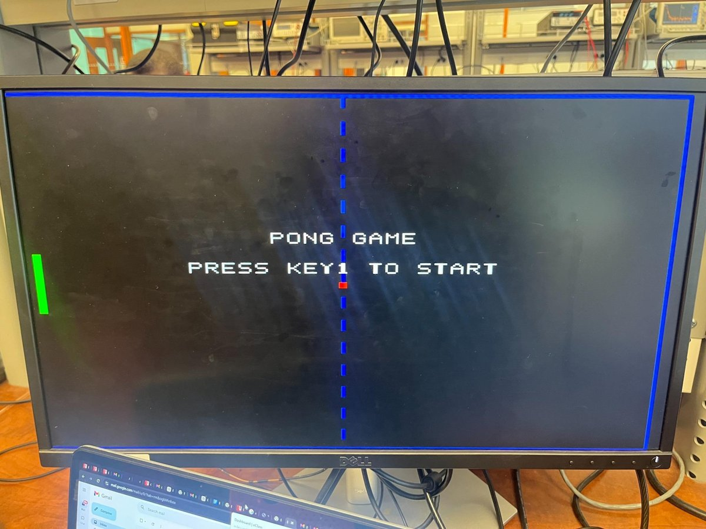
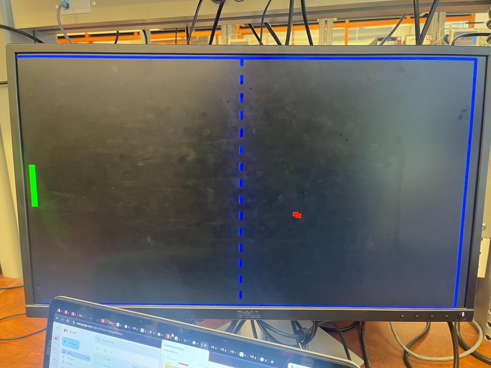
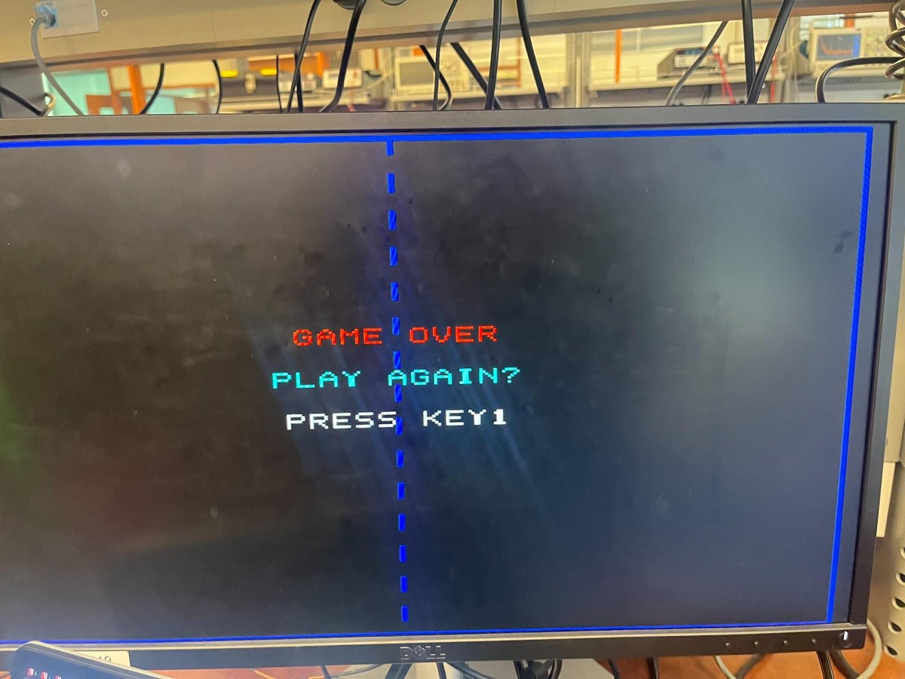
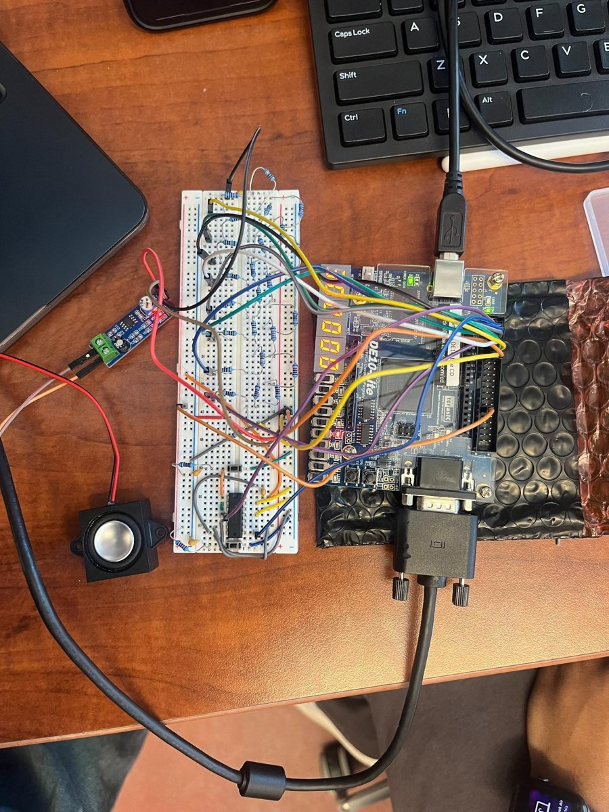
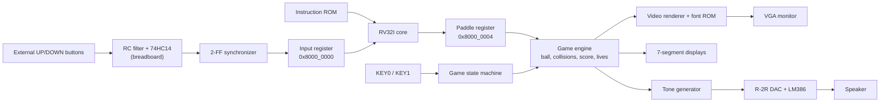

# RISC-V FPGA Pong

A single-player Pong game on an Intel DE10-Lite FPGA, controlled by a custom RV32I processor, with 640×480 VGA graphics, 7-segment scoring, and sound through a hand-built R-2R ladder DAC.

<p align="center">
  
  
  
</p>

## Highlights

- **Custom single-cycle RV32I CPU** ([`rv32i_min.v`](rtl/rv32i_min.v)) implementing the seven instructions the game needs: `LUI`, `ADDI`, `ANDI`, `LW`, `SW`, `BEQ`, `JAL`.
- **Memory-mapped I/O:** the CPU reads the buttons at `0x8000_0000` and writes the paddle position to `0x8000_0004`.
- **Hardware game engine:** ball physics, wall and paddle collisions, BCD score, and three lives, updated once per frame at 60 Hz.
- **640×480 @ 60 Hz VGA** rendered pixel-by-pixel in real time (no framebuffer), with an 8×8 bitmap font for on-screen text.
- **8-bit audio at 48 kHz** from a phase-accumulator tone generator, converted to analog by an external R-2R ladder and amplified by an LM386 module.
- **Two-stage button conditioning:** an RC filter and 74HC14 Schmitt trigger on the breadboard, then a two-flip-flop synchronizer inside the FPGA.

## Hardware

<p align="center">
  
</p>

| Part | Details |
| --- | --- |
| FPGA board | Intel DE10-Lite (MAX 10, 10M50) |
| Display | VGA monitor, 640×480 @ 60 Hz |
| Paddle buttons | Two external pushbuttons, each with an RC filter (10 kΩ, 100 nF, τ = 1 ms) and a 74HC14 Schmitt trigger |
| Audio | 8-bit R-2R ladder (10 kΩ for R, two 10 kΩ in series for 2R), AC-coupled into an LM386 amplifier and speaker |
| HDL | Verilog |
| Tools | Quartus Prime Lite 16.1 |

The 10 kΩ resistor values keep the current drawn from the DE10-Lite GPIO pins at a safe level. Hand-drawn schematics of both circuits are in [`docs/images/circuit-notes.png`](docs/images/circuit-notes.png).

## System Architecture



The design splits work between software and hardware. The RV32I core runs the paddle-control program, while time-critical tasks (VGA timing, ball physics, collision detection, and audio synthesis) run in dedicated hardware. A PLL turns the board's 50 MHz clock into a ~25.175 MHz pixel clock that drives the whole design.

The top-level state machine moves between **Title → Countdown → Playing ⇄ Paused → Game Over / Win**, and the renderer and audio change with each state.

### Memory Map

| Address | Register | Access | Contents |
| --- | --- | --- | --- |
| `0x0000_0000` | Instruction ROM | Fetch | 13-instruction paddle-control program |
| `0x8000_0000` | Input | CPU reads | bit 0 = UP, bit 1 = DOWN (one event per frame, cleared on read) |
| `0x8000_0004` | Paddle | CPU writes | bits 9:0 = paddle Y position |

## The Software

The CPU runs a short loop that reads the buttons, moves the paddle 4 pixels, and writes the new position back to hardware. Full listing with machine code: [`sw/paddle_control.s`](sw/paddle_control.s).

```asm
        lui   x1, 0x80000           # x1 = 0x8000_0000 (input register)
        addi  x2, x1, 4             # x2 = 0x8000_0004 (paddle register)
        addi  x3, x0, 200           # paddle starts near the middle
        sw    x3, 0(x2)
loop:
        lw    x4, 0(x1)             # read button events
        andi  x5, x4, 1             # UP?
        beq   x5, x0, check_down
        addi  x3, x3, -4
check_down:
        andi  x5, x4, 2             # DOWN?
        beq   x5, x0, store
        addi  x3, x3, 4
store:
        sw    x3, 0(x2)             # send new position to the game engine
        jal   x0, loop
```

### How the program gets into instruction memory

There is no assembler step in the build. The 13 instructions were hand-assembled into RV32I machine code and hard-coded in [`rtl/instr_rom.v`](rtl/instr_rom.v) as a `case` statement, so Quartus synthesizes the ROM into logic (the design uses no block RAM). To change the program, assemble new code with any RV32I assembler, replace the hex words in `instr_rom.v`, and recompile. New code must stick to the seven instructions the core supports.

## Debugging and Design Challenges

**Button polarity after the Schmitt trigger.** The 74HC14 inverts its input while cleaning up the edge, so the external buttons' polarity had to be re-checked once the conditioning circuit was wired in. To see how the FPGA interprets the buttons directly on the board, `LEDR[0]`–`LEDR[3]` are wired to the decoded signals (up pressed, down pressed, up only, down only). After testing, the final design treats the external buttons as active-low and inverts them after synchronization. The active-high alternative is left commented in [`de10lite_pong_top.v`](rtl/de10lite_pong_top.v).

**A CPU much faster than the screen.** The paddle loop is at most nine instructions on a core that executes one instruction per clock at ~25 MHz, so it runs millions of times per second while the screen only updates 60 times per second. Left unchecked, holding a button would push the paddle to the edge almost instantly, and the paddle could change position partway through a frame. Two pieces of hardware fix this:
- [`input_event_sticky.v`](rtl/input_event_sticky.v) samples the buttons once per frame and clears the event when the CPU reads it, so the CPU sees at most one movement event per frame (4 px per frame, or 240 px/s).
- The game engine buffers the CPU's paddle writes and applies them only on the frame tick, so every frame shows a consistent paddle and ball position.

**No false presses after reset.** Because the buttons are active-low, [`sync_2ff.v`](rtl/sync_2ff.v) resets its flip-flops to 1. Resetting them to 0 would look like a button press the moment the system leaves reset. The CPU also gets a short soft reset at the start of every game so the paddle program always restarts cleanly.

### Testing

The system was tested on the physical hardware in the lab, connected to a VGA monitor, the breadboard circuitry, and the speaker. Test scenarios covered power-up and the title screen, paddle movement and collisions during play, score and lives through to game over, restart without reprogramming, and the audio events. Simulation testbenches were not part of this version (see Future Improvements).

## Controls

| Input | Action |
| --- | --- |
| `KEY1` | Start the game, resume from pause, or play again after game over or a win |
| `KEY0` | Pause during play; while paused, restart with a fresh countdown |
| External UP / DOWN buttons | Move the paddle |
| `SW9` | Reset: keep it off to run, switch it on to hold the system in reset |

You have three lives. Each successful return scores a point, three misses end the game, and the game is won at 99,999 points. A 3-2-1 countdown with beeps runs before play starts.

**Displays:** `HEX4`–`HEX0` show the score (blinking on game over or a win), `HEX5` shows lives left, `LEDR0`–`LEDR3` show the button inputs, and `LEDR4`–`LEDR9` show the current game state.

**Sounds:** a short high beep on a hit, a lower two-part tone on a miss, descending notes on game over, ascending notes on a win, countdown beeps with a "go" sound, and a chime every five points.

## External Pin Assignments

| Signal | FPGA pins | Connects to |
| --- | --- | --- |
| `GPIO_UP_RAW` | `PIN_V10` | UP button (after the debounce circuit) |
| `GPIO_DOWN_RAW` | `PIN_W10` | DOWN button (after the debounce circuit) |
| `GPIO_DAC[7:0]` | `V5, W6, W7, V7, W8, V8, W9, V9` (bit 7 → bit 0) | R-2R ladder inputs |

All are 3.3-V LVTTL. The full pin list is in [`speaker_riscv_pong.qsf`](speaker_riscv_pong.qsf).

## Repository Structure

```
riscv-fpga-pong/
├── rtl/                          # Verilog source
│   ├── de10lite_pong_top.v       # Top level: state machine, MMIO, integration
│   ├── rv32i_min.v               # Minimal single-cycle RV32I core
│   ├── instr_rom.v               # Hard-coded paddle-control program
│   ├── pong_engine_lives_score.v # Ball motion, collisions, score, lives
│   ├── pong_video.v              # Object rendering and text overlay
│   ├── vga_sync_640x480.v        # VGA timing and frame tick
│   ├── font8x8_min.v             # 8x8 character bitmaps
│   ├── dac_audio_r2r.v           # Event-driven 8-bit audio synthesis
│   ├── input_event_sticky.v      # Once-per-frame button events for the CPU
│   ├── key_press.v               # Single-pulse KEY detection
│   ├── sync_2ff.v                # Two-flip-flop synchronizer
│   └── seg7.v                    # BCD to 7-segment decoder
├── ip/                           # PLL IP (50 MHz → 25.175 MHz)
├── sw/paddle_control.s           # Assembly listing of the ROM program
├── docs/
│   ├── EECS3216_Project_Report.pdf
│   └── images/
├── speaker_riscv_pong.qpf        # Quartus project
└── speaker_riscv_pong.qsf        # Device, pin, and file settings
```

## Build and Run

1. Install Quartus Prime Lite (the project was last built in 16.1; newer versions may ask to upgrade the PLL IP, which is fine).
2. Clone this repo and open `speaker_riscv_pong.qpf`.
3. Make sure `ip/` contains `pll.qip` and `pll.v`. If not, regenerate the PLL using the steps in [`ip/README.md`](ip/README.md).
4. Run **Processing > Start Compilation**.
5. Connect the DE10-Lite over USB and program it with `output_files/speaker_riscv_pong.sof` using the Quartus Programmer.
6. Connect the VGA monitor, the external buttons, and the DAC circuit (see the pin table above), keep `SW9` off, and press `KEY1` to start.

## Resource Usage

Estimated usage on the MAX 10 (10M50), from the project report:

| Resource | Used | Available | Share |
| --- | --- | --- | --- |
| Logic elements | ~2,200 | 49,760 | ~4% |
| Registers | ~1,250 | 49,760 | ~2.5% |
| Block RAM bits | 0 | 1,638,400 | 0% |
| I/O pins | 89 | 320 | ~28% |
| PLLs | 1 | 4 | 25% |

## Design Documents

- [Full project report](docs/EECS3216_Project_Report.pdf): architecture, external circuits, debounce analysis, and test results.
- [Debounce state diagram](docs/images/debounce-fsm.png) and [logic circuit](docs/images/debounce-logic.png): a four-state FSM (IDLE → WAIT1 → WAIT2 → ACCEPTED) derived with Karnaugh maps, used as the theoretical model for debouncing. The final build implements debouncing with the RC/Schmitt-trigger circuit plus the synchronizer and edge-detector modules.

## Future Improvements

- Move more gameplay into software, such as difficulty levels, variable ball speed, or pause menus.
- Add a second player or an AI-controlled paddle.
- Richer audio (wider samples, envelopes) and animated screen transitions.
- Simulation testbenches for the synchronizer, edge detector, CPU instructions, and collision handling.

## Authors

Built by **Mohammad Mustafidur Rahman** and **Kafi Anan** for EECS 3216 at York University. Standard 640×480 VGA timing and basic 7-segment decoding were adapted from engineering references and course lab material; the rest of the design is the team's original work.
